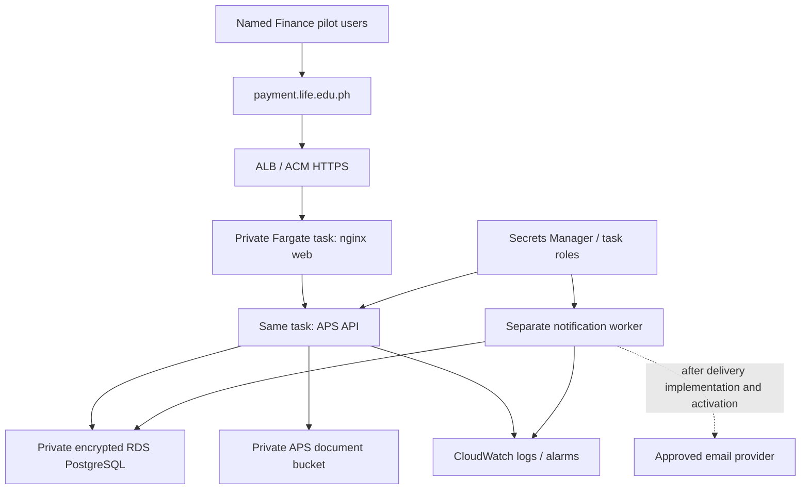

# APS AWS deployment plan — 12 November 2026

Status: planning baseline; no AWS provisioning or production activation performed.

## Confirmed direction

- Launch to a **Finance pilot first**, then expand after business acceptance.
- Follow the deployment pattern recorded for Events, in **Singapore (`ap-southeast-1`)**.
- Production hostname: **payment.life.edu.ph**.
- Proposed staging hostname: **payment-staging.life.edu.ph**, subject to DNS availability.
- Use real Finance configuration at activation; do not activate sample accounts or tax settings.

This plan adapts Events infrastructure conventions. It does not authorize changes to Events or reuse its application credentials, database, user accounts, or document storage.

## Events reference and APS differences

The reference is the local `unified-attendance` repository, especially `deploy/production/README.md`, `RELEASE_STATUS.md`, `build_infrastructure.py`, `build_task.py`, and `deploy/ci/README.md`. These are recorded deployment evidence, not a fresh inspection of the AWS account.

| Area | Events recorded baseline | APS deployment treatment |
| --- | --- | --- |
| Runtime | ECS Fargate, private application tasks | Adopt; APS web and API containers in one task initially, worker in a separate service |
| Ingress | ALB, ACM HTTPS, DNS alias | Adopt with separate APS target group, certificate coverage and hostname |
| Database | Private encrypted Multi-AZ RDS PostgreSQL; recorded version 18.3 | Dedicated APS database/credentials. APS currently tests PostgreSQL 16; validate the target major before selecting 18.3 |
| Database sizing | db.t4g.micro, 20 GiB with storage growth | Reference only; confirm capacity and connection limits under APS load |
| Application sizing | 0.5 vCPU / 1 GiB, one application task | Reference only; measure combined APS web/API and worker needs |
| Backups | 14-day database backup retention | Initial technical baseline; confirm Finance retention and recovery objectives |
| Registry and releases | ECR, immutable releases, isolated migration task | Adopt; build both APS deployment images and promote their exact digests |
| Secrets and identity | Secrets Manager and scoped task roles | Separate APS secrets/roles; no static AWS keys in containers |
| Files | Private versioned S3 for Events assets | Dedicated APS financial-document bucket and access policy; additional scanning requirements |
| Operations | CloudWatch, bounded logs, alarms | Adopt; Events records 90-day logs, subject to APS data/privacy review |
| Delivery automation | Manual release tooling; GitHub OIDC workflow prepared | Build APS workflow; do not assume Events GitHub deployment is already activated |

Existing VPC/subnets and possibly the ALB may be reusable after an infrastructure owner checks capacity, routing, ownership and failure impact. Do not hard-code Events resource IDs. Keep staging and production data, secrets and storage separate. The proposed shared vendor data belongs to APS/Procurement, not Events.

## Proposed architecture

Only the ALB accepts public application traffic. Security groups restrict ALB-to-web and application-to-database access. Private tasks need a reviewed egress design for image pulls, logs, secrets, storage and any external mail/integration endpoints. Compare NAT and VPC endpoint costs before provisioning.

For availability, one task is a pilot cost option, not application high availability. If the pilot requires uninterrupted service during a task failure, use at least two application tasks across availability zones and test shared sessions/background jobs. Multi-AZ RDS alone does not provide application redundancy.

## Work package 1 — release scope and ownership

Owner: application lead, Finance lead and infrastructure owner.

1. Name the pilot requestors, cost centers, Department Heads, Finance Associate, Finance Manager, Signatory and any executive reviewers needed by pilot routes.
2. Record enabled request types. If live Procurement APIs are unavailable, exclude production PO creation until the source contract is ready; retain demonstrations in staging only.
3. Implement the agreed Signatory one-click approval before release. Current committed payment execution has removed this gate; it must not be described as already operational. Target: Finance Manager certifies voucher, assigned Signatory approves the payment, Finance Associate releases, Finance Manager clears. Preserve the Petty Cash Finance Associate-only exception.
4. Assign support, incident, backup/restore and release owners. Define the pilot acceptance checklist and support hours.
5. Confirm DNS ownership, hosting budget, retention and recovery targets. Reusing Events architecture does not establish an APS cost approval.

Exit: signed scope and named owners; Signatory behavior matches the operating workflow.

## Work package 2 — deployment code and access safeguards

Owner: application and infrastructure engineers.

| Current location | Required work | Acceptance evidence |
| --- | --- | --- |
| `deploy/nginx.conf` | Replace Compose-only `api:8002` discovery for ECS with the chosen same-task localhost upstream. Preserve public HTTPS protocol safely across ALB/nginx; configure trusted forwarding boundaries | HTTPS login, cookies, redirects and URLs work; forged forwarded headers cannot bypass policy |
| `deploy/Dockerfile.api`, `deploy/Dockerfile.web` | Pin reviewed base image digests and reproducible dependencies; include verified RDS CA delivery | Rebuildable images, scans reviewed, non-root runtime and verified DB TLS |
| `deploy/compose.yml` and new AWS task definitions | Define web/API health dependencies, essential containers, worker command, CPU/memory, roles, logs and private networking | Failed API removes unhealthy application task; worker failure raises an alert |
| Health endpoints | Validate DB readiness through the actual ALB path and Host handling; separately probe S3 and worker progress | Healthy static nginx cannot conceal a failed API/database |
| `deploy/deployment.env.example` | Complete per-environment public URLs, allowed hosts, bucket and mail defaults; inject secrets outside Git | Staging cannot link users to localhost or production; production rejects demo credentials |
| Administrative access | Implement reviewed one-time real administrator bootstrap, account recovery and login abuse controls; disable demo role selection | First admin is created without sample seed; unauthorized creation/recovery and repeated login attempts are tested |
| Release automation | Add ECR builds, migration task and ECS promotion with scoped temporary credentials and an environment approval gate | Commit-to-image traceability and controlled rollback; no broad administrative deployment role |

For same-task ECS `awsvpc` networking, containers can communicate through localhost ([AWS task networking](https://docs.aws.amazon.com/AmazonECS/latest/developerguide/task-networking-awsvpc.html)). ALB supplies the original client protocol in `X-Forwarded-Proto`; the application must handle it within the trusted proxy chain ([AWS forwarded headers](https://docs.aws.amazon.com/elasticloadbalancing/latest/application/x-forwarded-headers.html)).

Exit: local deployment-image smoke tests pass and staging infrastructure can be created without manual secret edits in source.

## Work package 3 — isolated staging infrastructure

Owner: infrastructure engineer.

1. Prepare reviewable infrastructure definitions using Events conventions, with APS-specific resource names, tags and least-privilege policies.
2. Provision staging ECR repositories, Fargate services, ALB target group, certificate/DNS, private RDS, S3, Secrets Manager and logging.
3. Select the PostgreSQL major using migration, regression and restore evidence. Do not select Events' recorded major solely for consistency.
4. Configure automated backups/PITR, encryption, versioning, deletion protection and bounded logs. Test IAM restrictions using unauthorized-role attempts.
5. Run migrations once using an isolated task. Do not run the development seed or startup migration routines.
6. Bootstrap staging administration and use fictional test records. Import only approved reference data into production later.

Exit: HTTPS and database/storage access work through the deployed stack; services remain private; secrets are absent from images/logs; infrastructure cost estimate is reviewed.

## Work package 4 — documents, notifications and operational safety

Owner: application/security engineers with Finance approval of policy.

- Define document scanning/quarantine behavior and implement the chosen provider. Acceptance must cover clean, infected, failed and delayed scans; blocked files must not become accepted financial evidence through another download path.
- Set document/audit retention, legal holds, access logging and deletion rules. Versioning is useful but is not a complete retention or independent recovery policy.
- Deploy the existing notification worker with restart behavior and progress/failure monitoring.
- Keep outbound email disabled initially. The SMTP scaffold is not a completed sending workflow: implement durable per-recipient jobs/attempts, activation cutoff, retries, uncertain outcomes, access rechecks and delivery failure handling before enabling pilot email.
- Recheck the Events mail identity/provider in Singapore before reusing its organizational sender pattern. Use separate APS configuration and an allowlisted test; do not send historical notifications on activation.
- Create alerts for API errors/latency, unhealthy tasks, worker backlog, database capacity, backup failure and storage/mail failures. Assign an owner and escalation contact to each.

Email can remain disabled for a pilot explicitly accepting in-app notifications. Missing required document safety and recovery controls must be resolved or formally scoped before real financial records are accepted.

Exit: failure scenarios have expected UI feedback and an operational recovery path, without duplicated financial actions or uncontrolled email sends.

## Work package 5 — hosted acceptance and recovery rehearsal

Owner: QA, Finance and infrastructure owners.

Existing local results (299 backend tests, 20 frontend tests and focused browser checks) are historical baseline evidence, not proof of AWS readiness. Re-run the applicable suite against the selected database major and release candidate.

| Test area | Required coverage |
| --- | --- |
| Requests and routes | All enabled types, cost-center approver, threshold boundaries, PHP/foreign currency, Petty Cash limit and exception |
| Approval corrections | Decline, return to requestor, return to Finance Associate and resume, executive information request, audited override |
| Finance | Required supplier/request documents, line flags, setup activation, tax/account defaults and overrides, posting and balancing |
| Voucher/payment | Voucher view/print, multiple payment lines, Signatory one-click gate, release/clear, duplicate-click protection, full recovery/replacement |
| Advances | Liquidation equal/excess/unused balance, full return verification and reconciliation totals |
| Permissions | Cross-user direct URLs/API calls, future approver exclusion, Finance/System Admin vendor access and Procurement ownership |
| Conversations | Tagging, inbox links, reached-stage visibility, scrolling and frozen composer |
| UI/errors | Desktop, phone and tablet; dialogs, long names/text, empty/error/retry states, network interruption and expired session |
| Operational | Task restart/rolling deployment, API/DB/S3 failure, worker retry, backup restore, secret rotation and rollback rehearsal |

Restore the database and representative document versions into an isolated environment. Reconcile requests, approvals, accounting, voucher/payment totals, recoveries and object references. Measure actual recovery time and recoverable data age against the agreed targets. Finance signs business acceptance separately from technical test completion.

Exit: no unresolved blocking defects; signed test record, restore evidence and rollback rehearsal attached to the release.

## Work package 6 — Finance pilot cutover

Owner: release lead with Finance and infrastructure approval.

1. Freeze the approved release commit and image digests; capture configuration versions and migration list.
2. Verify production resources, DNS/certificate, backups, alarms, named-user access and support contacts.
3. Run reviewed migrations and one-time administrator bootstrap. Load approved cost centers/users/vendors/accounts/tax configuration using controlled, repeatable imports. Never seed sample transactions.
4. Finance completes initial setup and activates only the accepted request scope. Preserve business acceptance as an explicit decision.
5. Perform a controlled pilot transaction with approved people and evidence through the enabled workflow; verify notifications, accounting, voucher output and reporting.
6. Open access to the named Finance pilot. Monitor closely; broaden access only after Finance confirms successful use and defect review.

Exit: Finance pilot accepted, reconciled transactions and operational checks recorded. A public hostname does not mean access is open to all staff.

## Rollback and financial-data protection

- Before migration, take a restorable backup and record the current task/image/configuration versions.
- Prefer additive, backward-compatible migrations. Review schema compatibility before an application rollback.
- For unhealthy application releases, revert to the prior approved task/image where compatible. ECS rollback does not reverse database writes.
- If financial correctness is in doubt, pause new writes and worker processing under an incident procedure; preserve logs and evidence.
- Do not automatically downgrade the database or restore over newly entered transactions. Restore separately, reconcile the write interval and obtain the incident owner's decision before recovery cutover.
- Record affected request/payment IDs and reconcile bank/release evidence before retrying actions. Never delete audit history to make balances appear correct.

## Cost and remaining decisions

Prepare an AWS estimate for ECS web/API and worker capacity, RDS Multi-AZ/storage/backups, ALB, NAT or endpoints, S3/versioning/scanning, CloudWatch, secrets, DNS and email. Compare it with the actual Events bill where the AWS owner permits access. No monthly amount is approved by this document.

Still needed before provisioning/activation:

1. AWS/DNS owner and permission to reuse any shared network/ingress resources.
2. Approved monthly estimate, application availability level and pilot user list.
3. Database version validation, recovery objectives and Finance retention policy.
4. Enabled pilot request types and whether local login/in-app notifications are accepted while SSO/live Procurement/email remain separate integrations.
5. Named business acceptance and support/incident owners.

These decisions do not prevent preparing deployment code and infrastructure templates. Actual resource creation, DNS changes and production activation remain separate release actions.

## AWS references

- [ECS deployment circuit breaker](https://docs.aws.amazon.com/AmazonECS/latest/developerguide/deployment-circuit-breaker.html): application deployment health and rollback behavior.
- [RDS automated backups](https://docs.aws.amazon.com/AmazonRDS/latest/UserGuide/USER_WorkingWithAutomatedBackups.html): backup and point-in-time recovery controls; verify restore in practice.
- [S3 versioning](https://docs.aws.amazon.com/AmazonS3/latest/userguide/Versioning.html): object version preservation and recovery.
- [ECR VPC endpoints](https://docs.aws.amazon.com/AmazonECR/latest/userguide/vpc-endpoints.html): private image-pull networking requirements.
- [SES production access](https://docs.aws.amazon.com/ses/latest/dg/request-production-access.html): regional sending activation and sandbox considerations.

## Immediate next development increment

Implement the agreed Signatory gate and production account bootstrap/recovery safeguards; then prepare APS ECS task/infrastructure definitions and deployment-image checks. Complete those reviewable changes before provisioning staging. This plan does not change application behavior or deploy AWS resources.
